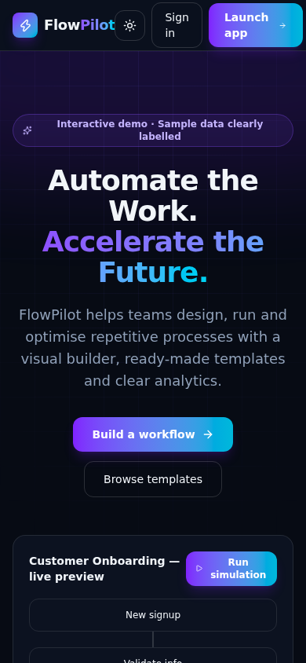
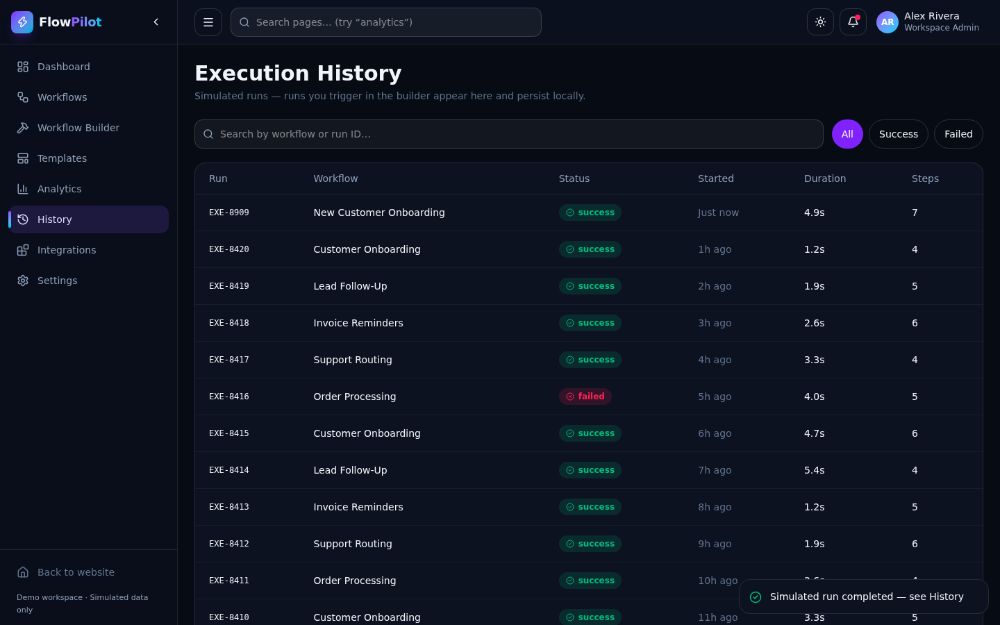
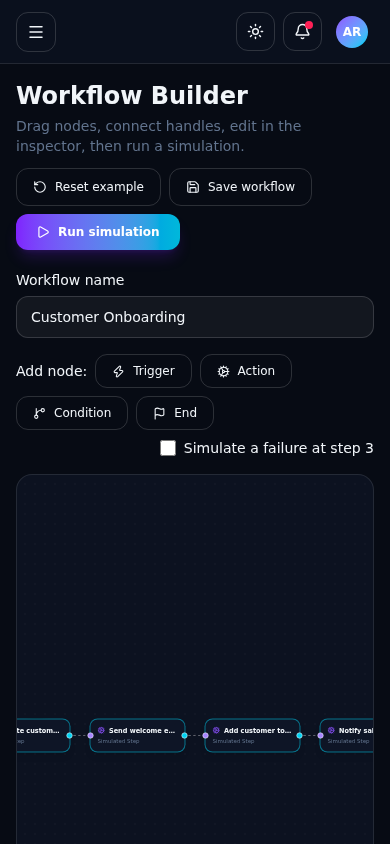

# FlowPilot — Intelligent Workflow Automation Platform

**Automate the Work. Accelerate the Future.**

FlowPilot is a premium, fully interactive SaaS front-end: a marketing website plus a working application with a visual workflow builder, template library, analytics, execution history, integration directory, and persistent settings.

> **Honest demo notice:** FlowPilot is a client-side product demonstration. Workflow executions are **simulated in the browser**, integrations are visual demos (no OAuth/API calls), pricing is illustrative, and all statistics are sample data — clearly labelled in the UI. Nothing is sent to external services.

## Screenshots

| Mobile home | Execution history | Mobile builder |
|---|---|---|
|  |  |  |

## Features

- **Marketing site** — animated hero with a runnable mini-workflow preview, features, how-it-works, templates, integrations, FAQ accordion, pricing with monthly/yearly toggle, about, and a validated demo contact form.
- **App dashboard** — stat cards derived from a single consistent dataset, 7/30-day chart range filters, recent activity (including your own simulated runs), workflow overview, loading skeletons.
- **Visual workflow builder** (React Flow) — add/move/connect/delete nodes, node inspector, zoom/pan/minimap, save/load via localStorage, step-by-step simulated execution with success/failure states and an optional forced failure, execution log.
- **Templates** — 6 realistic templates (customer/employee onboarding, lead follow-up, invoice reminders, support routing, order processing) with search, category filters, detail preview, and one-click loading into the builder.
- **Analytics** — Recharts volume/outcome charts and per-workflow performance, all calculated live from the same mock dataset.
- **History** — searchable/filterable execution log; builder runs persist locally and appear instantly.
- **Integrations** — 8 demo integration cards (Gmail, Sheets, Slack, Discord, Notion, Trello, GitHub, Webhooks) with honest local-only connect states.
- **Settings** — validated profile/notification preferences persisted to localStorage, plus in-app help docs.
- Dark/light themes, collapsible sidebar, notifications & profile menus, global page search, toasts, responsive mobile navigation, keyboard focus states, `prefers-reduced-motion` support.

## Tech Stack

React 19 · TypeScript · Vite · Tailwind CSS v4 · React Router · React Flow (`@xyflow/react`) · Recharts · Framer Motion · Lucide icons

## Quick Start

```bash
npm install
npm run dev        # http://localhost:5173
npm run build      # production build into dist/
npm run preview    # preview the production build
```

## Architecture

```
src/
  components/  common (toast, UI primitives) · layout (marketing + app shells) · marketing
  pages/       marketing (Home, Features, Templates, Pricing, About, Contact) · app (Dashboard, Builder, Workflows, Analytics, History, Integrations, Settings)
  features/    workflow template → React Flow conversion
  data/        single deterministic mock dataset (templates, workflows, executions, 30-day series, integrations)
  utils/       typed localStorage store
  types/       shared TypeScript types
```

Routing uses `HashRouter` and Vite `base: './'`, so every route works when served statically from GitHub Pages (including direct/deep links) with no server rewrites. App routes are lazy-loaded.

## GitHub Pages Deployment

1. Push this repository to GitHub as `flowpilot`.
2. In **Settings → Pages**, set Source to **GitHub Actions**.
3. Push to `main` (or run the workflow manually) — `.github/workflows/deploy.yml` builds and deploys automatically.

No secrets or environment variables are required.

## QA Performed

- `npm run build` (TypeScript + Vite) — passes cleanly.
- Playwright (Chromium) sweep of all 14 routes — content renders, **zero console errors**.
- Interaction tests: template → builder loading, node creation (6 → 7 nodes), save, full simulated run, run appearing in History, and mobile (390px) builder with no horizontal overflow.

## Limitations

- Simulated executions only; no backend, auth, payments, or real third-party integrations.
- Data persistence is browser localStorage only and is per-device.
- Sample statistics, customer names, and time-saved figures are illustrative placeholders, labelled as such in the UI.

## License

MIT — see [LICENSE](LICENSE).
